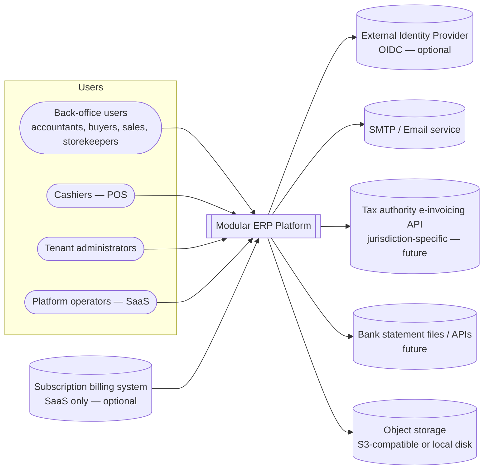
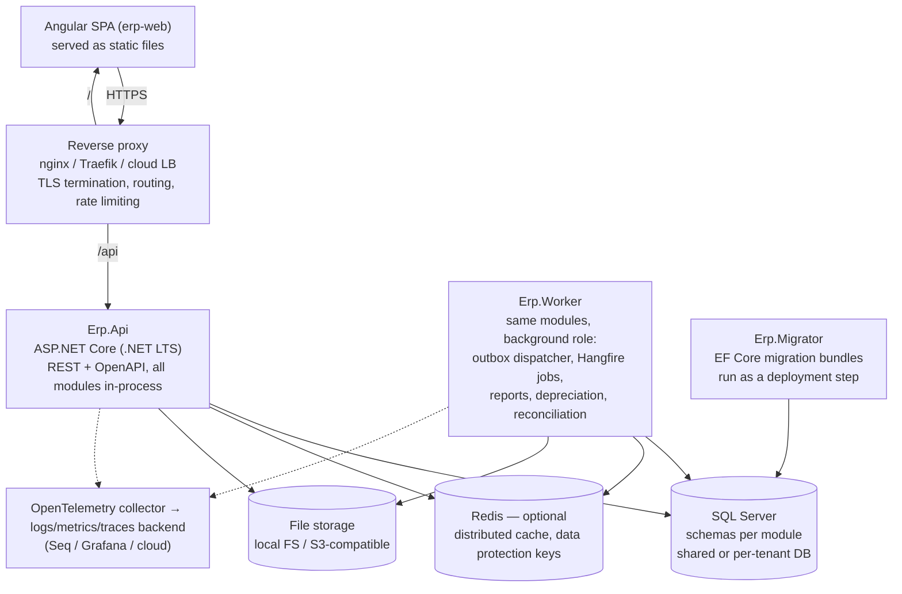
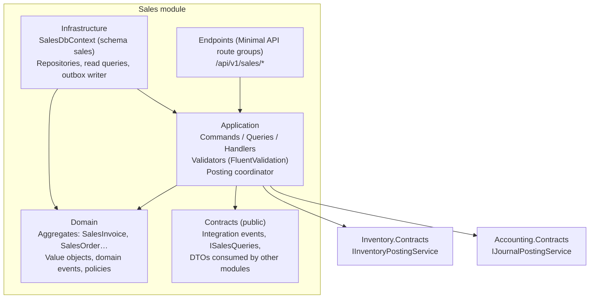

# 2. Proposed Solution Architecture

## 2.1 Architectural style

**Modular monolith** with **Clean Architecture inside each module** and **DDD bounded contexts as module boundaries** (ADR-001, ADR-002). One deployable backend (API host + worker host built from the same code), one SQL Server database (in the shared-tenancy model) with **one schema and one DbContext per module**.

Why not microservices now: ERP posting flows (invoice → inventory → COGS → GL) need strong consistency, the team and domain are still being discovered, and operational cost of distributed systems is high for on-prem customers. The boundaries below are designed so a module can later be extracted (own DB, async integration through the outbox) without rewriting its domain.

## 2.2 C4 — Level 1: System context



## 2.3 C4 — Level 2: Containers



* API and Worker are **the same codebase and image**, started in different roles (`ERP_ROLE=api|worker|all`). On small on-prem installs a single process runs `all`.
* Redis is **optional**: an in-memory cache and DB-backed data-protection key ring are used when Redis is not configured (ADR-014).

## 2.4 C4 — Level 3: Inside one module (example: Sales)



## 2.5 Backend solution structure

```
backend/src
├── Host
│   ├── Erp.Api                 # composition root, middleware, auth, OpenAPI, module registration
│   ├── Erp.Worker              # background composition root
│   └── Erp.Migrator            # runs per-module migrations in dependency order
├── BuildingBlocks
│   ├── Erp.SharedKernel        # Entity, AggregateRoot, ValueObject, DomainEvent, Result, Money, Quantity, errors
│   ├── Erp.Application         # ICommand/IQuery + handlers, pipeline behaviors (validation, transaction, audit),
│   │                           # ITenantContext, ICurrentUser, IClock, IUnitOfWork, IIdempotencyStore
│   ├── Erp.Infrastructure      # EF Core base DbContext (tenant filters, audit, rowversion), outbox, inbox,
│   │                           # numbering, file storage, cache, email, Hangfire, Serilog, OpenTelemetry
│   └── Erp.Web                 # endpoint conventions, problem details, permission filters, module filters
└── Modules
    ├── Identity        ├── Organization   ├── Configuration  ├── Catalog
    ├── Parties         ├── Tax            ├── Sales          ├── Pos
    ├── Procurement     ├── Inventory      ├── Manufacturing  ├── Accounting
    ├── Finance         ├── FixedAssets    ├── Workflow       ├── Audit
    ├── Documents       └── Reporting
        each:  Erp.Modules.<X>.Domain
               Erp.Modules.<X>.Application
               Erp.Modules.<X>.Infrastructure   (EF, endpoints, module installer)
               Erp.Modules.<X>.Contracts        (the ONLY project other modules may reference)
```

### Dependency rules (enforced by architecture tests — NetArchTest/ArchUnitNET)

1. `Domain` → `SharedKernel` only. No EF Core, no ASP.NET, no other module.
2. `Application` → own `Domain`, `Erp.Application`, **other modules' `Contracts` only**.
3. `Infrastructure` → own `Application`/`Domain`, `Erp.Infrastructure`, `Erp.Web`.
4. `Contracts` → `SharedKernel` primitives only (no domain types leak).
5. A module never references another module's `Domain`, `Application` or `Infrastructure`, and never queries another module's tables.
6. Hosts reference every module's `Infrastructure` (composition only).

## 2.6 Inter-module communication

| Need | Mechanism | Consistency |
|---|---|---|
| Read reference data of another module (e.g. Sales needs product UOM, tax code) | Synchronous in-process call to `X.Contracts` query interface (e.g. `ICatalogQueries.GetProductsForSale(ids)`) — cached where safe | Immediate |
| Core posting effects (inventory issue, journal creation) as part of a source-document posting | Synchronous in-process call to an **idempotent posting contract** inside the **same DB transaction** (ADR-006) | Atomic |
| Side effects that can lag (notifications, read models, search, webhooks, audit projections, commission accrual triggers) | **Integration events** written to the **outbox** in the same transaction, dispatched by the worker; consumers use an **inbox** for idempotency | Eventual |
| Within a module | Domain events dispatched before commit (same transaction) | Atomic |

Posting contracts are deliberately shaped like messages (`PostInventoryMovements(sourceRef, lines…)`, keyed by a unique `SourceDocumentReference`) so that, if a module is extracted later, the call can become an asynchronous command with a compensating action without changing the domain (see [07-transaction-consistency.md](07-transaction-consistency.md)).

## 2.7 CQRS (where it adds value)

* **Commands** go through aggregates and repositories (EF Core change tracking, invariants, rowversion).
* **Queries** bypass aggregates: `AsNoTracking` projections to DTOs, or raw SQL / views for reports. No repository for reads.
* Separate read store is **not** introduced initially; reporting read models (summary tables) are added per report only when measured performance requires (ADR-016).
* A small in-house dispatcher (`ICommandHandler<TCommand,TResult>`, `IQueryHandler<…>`, pipeline behaviors) is used instead of MediatR (ADR-012: licensing change of MediatR; we need ~150 lines of code).

## 2.8 Cross-cutting pipeline (per command)

```mermaid
flowchart LR
    A[HTTP request] --> B[Auth: JWT validation]
    B --> C[Tenant & company context resolution]
    C --> D[Module-enabled filter]
    D --> E[Permission filter]
    E --> F[Idempotency check<br/>for posting/POS commands]
    F --> G[Validation behavior<br/>FluentValidation]
    G --> H[Transaction behavior<br/>BEGIN TRAN — commands only]
    H --> I[Handler → Aggregates]
    I --> J[Domain events dispatched]
    J --> K[Audit + Outbox rows written]
    K --> L[COMMIT]
    L --> M[ProblemDetails / Result mapping]
```



## 2.9 Technology stack (with justification)

| Concern | Choice | Reason / note |
|---|---|---|
| Runtime | **.NET 10 LTS** (latest LTS as of 2026-11); upgrade path to next LTS | Spec: latest LTS |
| Web | ASP.NET Core Minimal APIs with route groups per module | Low ceremony, endpoint filters for permission/module checks, first-class OpenAPI |
| ORM | EF Core (matching .NET version), SQL Server provider | Spec; migrations per DbContext |
| Validation | FluentValidation | Spec |
| Auth | ASP.NET Core Identity (user store, password hashing, lockout, MFA) + own JWT issuer + rotating refresh tokens; optional OIDC federation | Spec; works offline on-prem |
| Logging | Serilog → console (JSON) + optional Seq/file sinks; OpenTelemetry for traces & metrics | Spec |
| API docs | ASP.NET Core OpenAPI document + Swagger UI / Scalar in non-prod | Spec |
| Jobs | Hangfire (SQL Server storage) for scheduled/recurring jobs; plain hosted service for outbox dispatch | Spec; no extra infra on-prem |
| Cache | `HybridCache` with optional Redis L2 | Works with and without Redis |
| Mapping | Hand-written mapping / projections | Avoid AutoMapper (commercial license since 2025, hides logic) |
| Excel export | ClosedXML (MIT) | |
| PDF | Behind `IPdfRenderer`; QuestPDF candidate (license threshold — OQ-LIC-1) | |
| Tests | xUnit, Shouldly, Testcontainers (SQL Server), Respawn, NetArchTest, Playwright | FluentAssertions avoided (commercial v8) |
| Frontend | Angular (latest stable, pinned at Phase 2 scaffold), standalone components, Signals, Angular Material + CDK (M3 theming, RTL via `Directionality`), Transloco for runtime i18n | See [05-frontend-architecture.md](05-frontend-architecture.md) |
| Containers | Docker images (API/Worker, Web, Migrator); Compose for on-prem/dev; optional Helm for SaaS | |
| CI/CD | GitHub Actions | Repository is on GitHub |

No message broker is introduced in v1: the outbox dispatcher delivers to in-process consumers. A broker (RabbitMQ / Azure Service Bus) is added only when a module is extracted (ADR-007).
