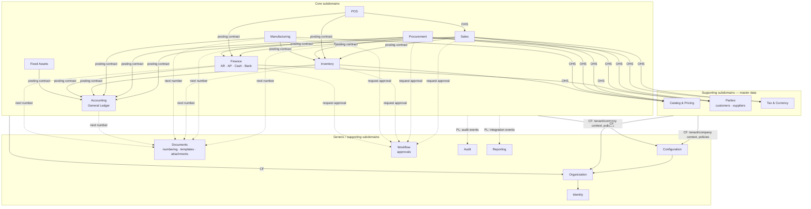

# 4. Bounded Context Diagram

## 4.1 Context map

Arrow `A → B` means *A depends on B's published contract* (B is upstream). Relationship types: **OHS** open-host service (published Contracts), **CF** conformist, **ACL** anti-corruption layer, **PL** published language (integration events).

Key design choices:

* **Accounting is downstream of nothing operational.** It exposes `IJournalPostingService` and knows nothing about invoices; it receives *journal requests* with semantic posting roles and source references. Account resolution (posting rules) lives inside Accounting so that operational modules never contain account IDs (Part 12.8, rule 15).
* **Finance (AR/AP/Cash) is separated from Accounting (GL).** Subledger concepts (open items, allocations, aging) change for different reasons than the GL. Finance posts to GL through the same contract.
* **Inventory owns quantities *and* inventory cost.** Sales and Manufacturing never compute cost; they receive the cost of the issue from Inventory's posting result and pass it to Accounting.
* **Workflow is generic.** Modules register *approvable document types* and evaluate "is approval required?" via the engine; the engine never posts anything (Part 16).
* **Reporting is a consumer.** It reads module-owned SQL views (read-only contracts published by each module) and its own summary tables fed by integration events. It never writes to module tables.

## 4.2 Context responsibilities and published language

| Context | Schema | Aggregates (summary) | Publishes (integration events) | Contracts offered |
|---|---|---|---|---|
| Identity | `identity` | User, Role, RefreshTokenFamily | `UserCreated`, `UserDeactivated`, `RolePermissionsChanged` | `IPermissionService` |
| Organization | `organization` | Tenant, Company, LegalEntity, Branch, Department, Warehouse, Employee | `CompanyCreated`, `WarehouseCreated` | `IOrganizationQueries` |
| Configuration | `core` | ModuleActivation, CompanyPolicySet, SystemSetting | `ModuleEnabled/Disabled`, `PolicyChanged` | `IModuleRegistry`, `IPolicyProvider<T>` |
| Catalog & Pricing | `catalog` | Product, ProductCategory, Brand, UnitOfMeasure/UomConversion, PriceList, DiscountRule | `ProductCreated`, `ProductPriceChanged` | `ICatalogQueries`, `IPriceCalculator` |
| Parties | `crm` | Customer, Supplier, CustomerGroup, PaymentTerms | `CustomerCreated`, `CreditProfileChanged` | `IPartyQueries` |
| Tax & Currency | `tax` | TaxCode, TaxGroup, Currency, ExchangeRateTable | `ExchangeRateRecorded` | `ITaxCalculator`, `IExchangeRateProvider` |
| Sales | `sales` | SalesQuotation, SalesOrder, DeliveryNote, SalesInvoice, SalesReturn, CommissionPlan | `SalesInvoicePosted`, `SalesOrderConfirmed`, `DeliveryPosted` | `ISalesQueries` |
| POS | `pos` | PosTerminal, CashierShift, PosReceipt | `PosShiftClosed` | — |
| Procurement | `procurement` | PurchaseRequest, PurchaseQuotation, PurchaseOrder, GoodsReceipt, PurchaseInvoice, PurchaseReturn, LandedCost | `GoodsReceiptPosted`, `PurchaseInvoicePosted` | `IProcurementQueries` (open PO supply for MRP) |
| Inventory | `inventory` | InventoryMovement (ledger), InventoryBalance, CostLayer, StockReservation, StockTransfer, StockAdjustment, StockCount, Batch, SerialNumber | `StockMovementsPosted`, `StockBelowReorderPoint` | `IInventoryPostingService`, `IReservationService`, `IStockQueries` |
| Manufacturing | `manufacturing` | BillOfMaterials (+versions), WorkCenter, Routing, ProductionOrder, MrpRun | `ProductionOrderCompleted` | `IManufacturingQueries` |
| Accounting | `accounting` | Account (COA), FiscalYear/Period, JournalEntry, PostingRuleSet, CostCenter, ProfitCenter | `JournalPosted`, `PeriodClosed` | `IJournalPostingService`, `IPeriodGuard`, `ILedgerQueries` |
| Finance | `finance` | CustomerOpenItem/SupplierOpenItem, Receipt, Payment, Allocation, CashAccount, BankAccount, BankReconciliation, Expense | `ReceiptPosted`, `PaymentPosted`, `InvoiceSettled` | `ISubledgerPostingService`, `ICreditExposureQueries` |
| Fixed Assets | `assets` | Asset, AssetCategory, DepreciationRun | `DepreciationPosted` | — |
| Workflow | `workflow` | ApprovalDefinition, ApprovalInstance | `ApprovalCompleted`, `ApprovalRejected` | `IApprovalService` |
| Audit | `audit` | AuditLog (append-only), DocumentHistory | — | `IAuditWriter` |
| Documents | `core` | NumberSequence, DocumentTemplate, Attachment | — | `IDocumentNumberGenerator`, `IAttachmentService` |
| Reporting | `reporting` | ReportDefinition, Dashboard, summary tables | — | — |

Note: the spec suggests separate `tax` and `finance` schemas; both are kept. Currency/exchange rates are placed in `tax` per Part 21's grouping ("Tax: TaxCode, TaxRate, TaxTransaction, ExchangeRate").
