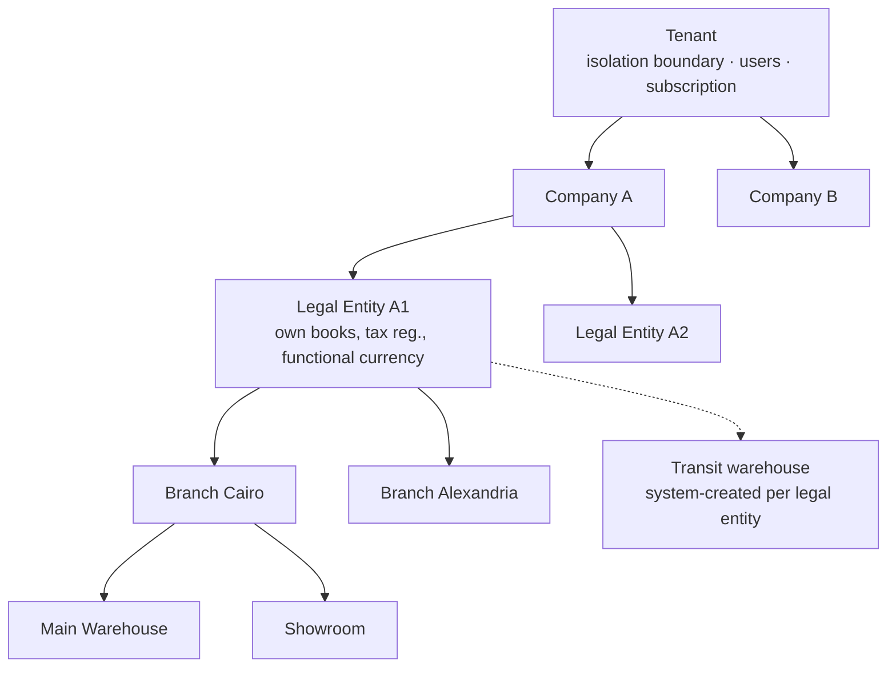
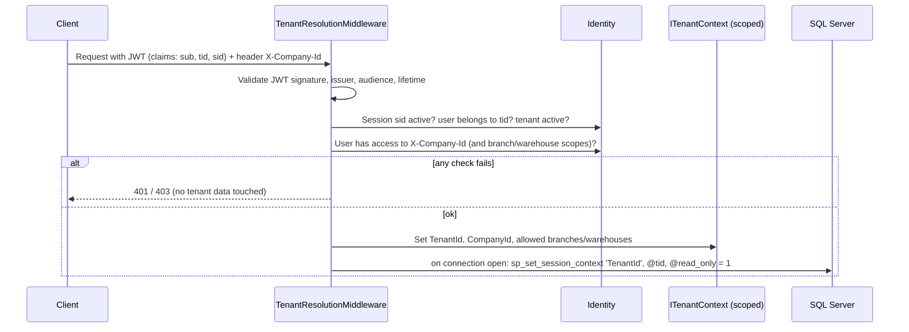

# 13. Multi-Tenancy Strategy

## 13.1 Hierarchy

| Level | Owns | Shared with children |
|---|---|---|
| Tenant | users, roles, tenant settings, module entitlements (license) | — |
| Company | module activation, policies, master data (products, customers, suppliers, price lists), numbering scopes | master data shared by all legal entities of the company (configurable per entity later) |
| Legal entity | chart of accounts assignment, fiscal calendar, journals, tax registrations, functional currency, open items, inventory valuation | — |
| Branch | users' branch restrictions, numbering, POS terminals, reporting dimension | — |
| Warehouse | stock balances, reservations | — |

COA: one chart **per company**, with each legal entity keeping separate books (journals carry `LegalEntityId`). A legal entity may override the chart (Account.LegalEntityId not null) when jurisdictions differ.

## 13.2 Isolation models

| Model | Where used | How |
|---|---|---|
| **Shared database, `TenantId` column** (default, v1) | SaaS small/medium tenants | Global query filters + SQL Server RLS + tenant-first indexes |
| **Database per tenant** | SaaS large/regulated tenants (Phase 11+) | Tenant catalog maps tenant → connection string; same schema & migrations; `TenantId` column retained (keeps code identical and allows moving a tenant back/forth) |
| **Dedicated on-prem database** | On-premises | Single-tenant mode: one tenant row created at install; tenant resolver returns it; RLS still active |

Per ADR-003, database-per-tenant routing is designed (interfaces + catalog table) but **not implemented until the shared model is stable**.

## 13.3 Tenant resolution (never trust the client)

* `TenantId` comes **only** from the validated token (issued by our own login after verifying membership). Any `tenantId` in a request body/query is ignored; API contracts don't contain it.
* `X-Company-Id` is a *selection*, verified against `UserCompanyAccess` on every request (cached, invalidated by `RolePermissionsChanged`/access change events).
* Background jobs and outbox consumers carry `TenantId` in the job/message envelope and establish an `ITenantContext` explicitly before touching data; a job without tenant context fails fast (except whitelisted platform jobs).
* Platform-operator endpoints (tenant provisioning) run in a separate route group with a separate policy and an explicit "cross-tenant" context that is audited.

## 13.4 Enforcement layers (defense in depth)

1. **EF Core global query filter** on every `ITenantScoped` entity: `e => e.TenantId == _tenant.TenantId` (and `CompanyId` for company-scoped entities). Applied automatically by convention in the base DbContext; an architecture test fails if a tenant-scoped entity lacks the filter.
2. **Write guard:** `SaveChanges` interceptor sets `TenantId` on insert and throws if a modified/deleted entity's `TenantId` differs from the context.
3. **SQL Server Row-Level Security:** security policy with filter **and** block predicates on `TenantId = CAST(SESSION_CONTEXT(N'TenantId') AS uniqueidentifier)`. Catches raw SQL, Dapper/report queries and `IgnoreQueryFilters()` mistakes. `@read_only = 1` prevents changing it within the connection.
4. **Tenant-first unique indexes:** uniqueness never leaks existence across tenants (e.g. same SKU in two tenants is allowed).
5. **Branch/warehouse restrictions** applied in application queries via `IDataScope` (not RLS — they are authorization, not isolation).
6. **Cache keys** are always prefixed with tenant id (`t:{tid}:…`) by the cache abstraction; a raw key API is not exposed.
7. **File storage** keys prefixed `tenants/{tid}/…`; download goes through an authorized endpoint (no public object URLs).

## 13.5 Cross-tenant isolation tests (mandatory in CI)

| Test | Expectation |
|---|---|
| Seed tenants A and B with identical codes; user of A lists/searches every resource type | Only A's rows |
| User of A requests B's resource by id (GET/PUT/POST actions) | 404 (not 403, to avoid existence disclosure) |
| User of A sends body containing `tenantId: B` | Ignored; row created in A |
| Raw SQL query executed with session context A | RLS returns only A |
| `IgnoreQueryFilters()` misuse simulated | RLS still blocks |
| Background job for tenant A | Cannot read B |
| Cache: same key logical name for A and B | Separate entries |
| Reflection test: every entity implementing `ITenantScoped` has a query filter and an RLS policy entry | Pass |

## 13.6 Tenant provisioning (SaaS)

1. Platform operator (or billing webhook via integration port) calls `POST /api/platform/tenants`.
2. Transaction: create tenant, admin user (invite e-mail), default company, legal entity, branch, main + transit warehouses, number sequences, COA from template, posting rule set from template, fiscal year, base currency, default roles.
3. Module entitlements from the license/subscription; company admin then enables modules within entitlements.
4. Outbox: `TenantProvisioned` → welcome notification, monitoring registration.

On-prem uses the same provisioning service, invoked once by the installer (`Erp.Migrator --init-tenant`).
