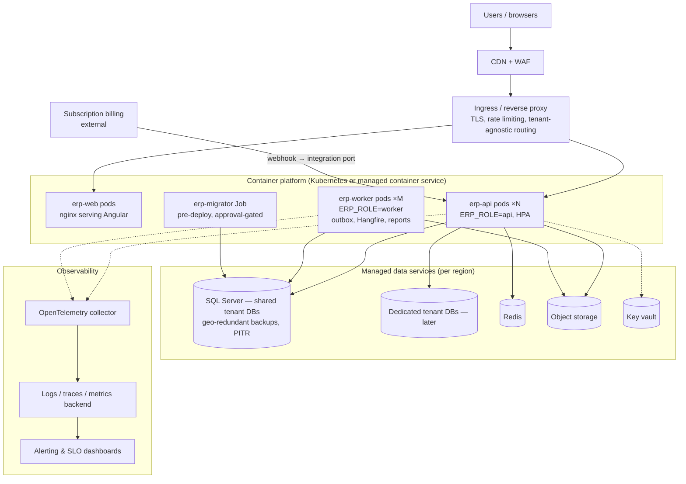
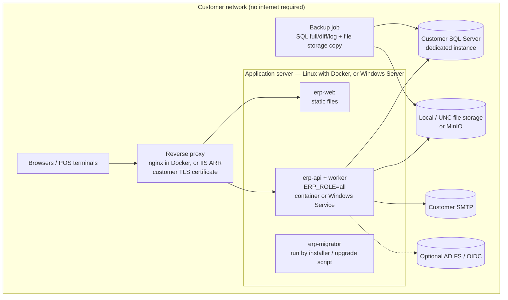
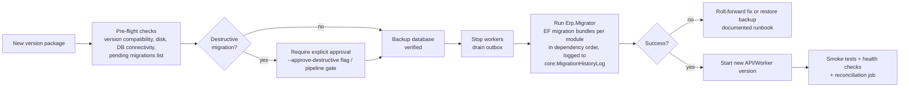

# 14–15. Cloud and On-Premises Deployment Architecture

One codebase, one set of container images, environment-specific **configuration** only (Part 20). Nothing environment-specific (connection strings, paths, storage provider, SMTP, Redis, IdP URLs, keys) is hardcoded.

## 14.1 Configuration model

| Source (later wins) | Use |
|---|---|
| `appsettings.json` | Safe defaults only — no secrets, no hostnames |
| `appsettings.{Environment}.json` | Non-secret environment defaults |
| Environment variables (`ERP__Storage__Provider=S3`) | Container deployments |
| Secret provider (`ISecretProvider`): Kubernetes secrets / cloud key vault / on-prem encrypted file or Windows DPAPI / Docker secrets | Connection strings, JWT signing keys, SMTP credentials |

Strongly typed options (`StorageOptions`, `EmailOptions`, `CacheOptions`, `IdentityProviderOptions`, `TenancyOptions { Mode = MultiTenant | SingleTenant }`, `DeploymentOptions { Mode = Cloud | OnPrem }`) validated at startup (`ValidateOnStart`) — the app refuses to start with invalid configuration.

## 14.2 Infrastructure abstractions and implementations

| Abstraction | Cloud SaaS | On-premises |
|---|---|---|
| `IFileStorage` | S3-compatible (AWS S3, MinIO, Azure Blob via adapter) | Local/UNC file system or MinIO |
| `ISecretProvider` | Cloud key vault / K8s secrets | Encrypted config / Docker secrets / DPAPI |
| `ICache` (HybridCache) | In-memory L1 + Redis L2 | In-memory only (Redis optional) |
| `IBackgroundJobs` | Hangfire (SQL Server storage), dedicated worker pods | Hangfire in the same process (`ERP_ROLE=all`) or separate worker service |
| `INotificationSender` | SMTP / transactional email provider adapter; in-app via SignalR | Configurable SMTP; in-app |
| `IIdentityProvider` federation | Optional OIDC (Entra ID, Google, Okta) | Local Identity (default), optional OIDC/ADFS; LDAP adapter later |
| Data-protection keys | Redis or DB, encrypted with key-vault key | DB, encrypted with certificate |
| `ILicenseProvider` | Subscription service integration port | Signed offline license file |

## 14.3 Cloud SaaS deployment

* **Stateless API**: no sticky sessions; auth is JWT; files go to object storage; SignalR uses Redis backplane when >1 replica.
* **Tenant catalog** (`platform` schema in a control database) maps tenants → database (shared or dedicated), region, status, entitlements.
* **Backups**: managed point-in-time restore (RPO ≤ 15 min), daily full retained per policy; per-tenant export tool for data portability.
* **Monitoring**: health endpoints `/health/live`, `/health/ready` (DB, storage, cache), per-tenant metrics tagged with tenant id (cardinality-limited), alert on outbox lag, failed postings, reconciliation differences.
* **Region pinning** for data residency (MR-11).

## 15. On-premises deployment

### Packaging options

| Option | Contents | Target |
|---|---|---|
| **Docker Compose bundle** | `docker-compose.onprem.yml`, images exported as tarballs (`docker save`) for **offline install**, `.env.template`, `install.sh` / `upgrade.sh` / `backup.sh` | Linux servers |
| **Windows bundle** | Self-contained .NET publish of API/Worker as Windows Service, Angular static files for IIS, PowerShell `Install-Erp.ps1`, `Upgrade-Erp.ps1` | Windows-only customers without Docker |
| Optional SQL Server container | For evaluation/small sites only; production should use a customer-managed SQL Server | |

### On-prem operational features

* Single-tenant mode (`Tenancy:Mode=SingleTenant`); tenant created at install.
* Customer-managed secrets: `.env`/Docker secrets or encrypted config; JWT signing key generated at install, never shipped.
* License: signed offline file (module entitlements, user count, expiry) validated with an embedded public key; grace period; no phone-home required.
* Health monitoring endpoints + optional Seq/Grafana compose profile.
* Configurable backups: scripts for SQL Server `BACKUP DATABASE` (full/diff/log) + file storage copy, retention, restore runbook and restore test procedure.

## 15.1 Database migration and upgrade process (cloud and on-prem)

Rules:

* Migrations are **never applied automatically at application startup in production** (ADR-015); the migrator is an explicit deployment step. Development may auto-migrate.
* Each module owns its migrations (`__EFMigrationsHistory` table per schema).
* Expand/contract pattern for breaking schema changes (add column → backfill → switch code → drop later in a separate, approved release).
* Idempotent SQL scripts (`dotnet ef migrations script --idempotent`) are produced for DBA-controlled on-prem environments.
* Migration classifier in CI flags destructive operations (drop column/table, type narrowing) and requires a reviewed approval label.

## 15.2 CI/CD (GitHub Actions)

| Stage | Steps |
|---|---|
| PR | backend build (warnings as errors), unit + architecture tests, integration tests with SQL Server Testcontainer, frontend lint/test/build, migration script generation + destructive-change check, dependency vulnerability scan, secret scanning |
| Main | build & sign images (`erp-api`, `erp-web`, `erp-migrator`), SBOM, push to registry, deploy to staging, E2E (Playwright) |
| Release | manual approval → production migrator job → rolling deploy; on-prem bundle (offline tarballs + scripts) attached to release |
