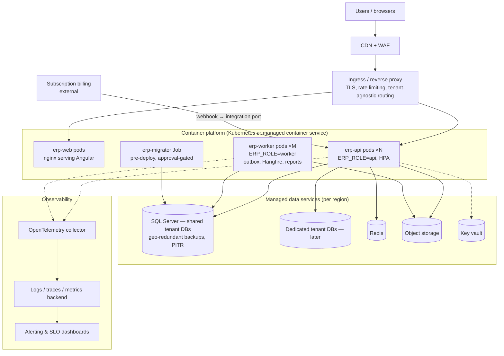
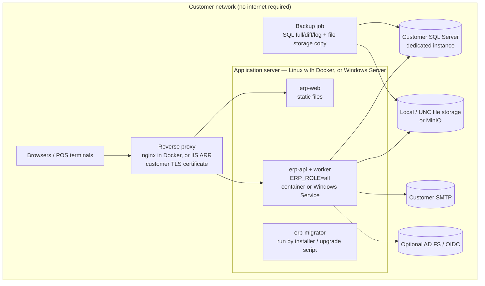
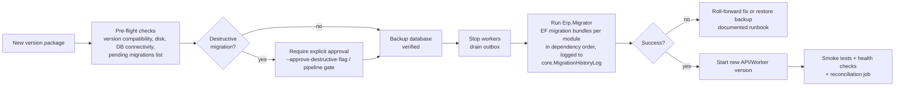

# 14–15. Cloud and On-Premises Deployment Architecture

One codebase, one set of container images, environment-specific **configuration** only (Part 20). Nothing environment-specific (connection strings, paths, storage provider, SMTP, Redis, IdP URLs, keys) is hardcoded.

## 14.1 Configuration model

| Source (later wins) | Use |
|---|---|
| `appsettings.json` | Safe defaults only — no secrets, no hostnames |
| `appsettings.{Environment}.json` | Non-secret environment defaults |
| Environment variables (`ERP__Storage__Provider=S3`) | Container deployments |
| Secret provider (`ISecretProvider`): Kubernetes secrets / cloud key vault / on-prem encrypted file or Windows DPAPI / Docker secrets | Connection strings, JWT signing keys, SMTP credentials |

Strongly typed options (`StorageOptions`, `EmailOptions`, `CacheOptions`, `IdentityProviderOptions`, `TenancyOptions { Mode = MultiTenant | SingleTenant }`, `DeploymentOptions { Mode = Cloud | OnPrem }`) validated at startup (`ValidateOnStart`) — the app refuses to start with invalid configuration.

## 14.2 Infrastructure abstractions and implementations

| Abstraction | Cloud SaaS | On-premises |
|---|---|---|
| `IFileStorage` | S3-compatible (AWS S3, MinIO, Azure Blob via adapter) | Local/UNC file system or MinIO |
| `ISecretProvider` | Cloud key vault / K8s secrets | Encrypted config / Docker secrets / DPAPI |
| `ICache` (HybridCache) | In-memory L1 + Redis L2 | In-memory only (Redis optional) |
| `IBackgroundJobs` | Hangfire (SQL Server storage), dedicated worker pods | Hangfire in the same process (`ERP_ROLE=all`) or separate worker service |
| `INotificationSender` | SMTP / transactional email provider adapter; in-app via SignalR | Configurable SMTP; in-app |
| `IIdentityProvider` federation | Optional OIDC (Entra ID, Google, Okta) | Local Identity (default), optional OIDC/ADFS; LDAP adapter later |
| Data-protection keys | Redis or DB, encrypted with key-vault key | DB, encrypted with certificate |
| `ILicenseProvider` | Subscription service integration port | Signed offline license file |

## 14.3 Cloud SaaS deployment

* **Stateless API**: no sticky sessions; auth is JWT; files go to object storage; SignalR uses Redis backplane when >1 replica.
* **Tenant catalog** (`platform` schema in a control database) maps tenants → database (shared or dedicated), region, status, entitlements.
* **Backups**: managed point-in-time restore (RPO ≤ 15 min), daily full retained per policy; per-tenant export tool for data portability.
* **Monitoring**: health endpoints `/health/live`, `/health/ready` (DB, storage, cache), per-tenant metrics tagged with tenant id (cardinality-limited), alert on outbox lag, failed postings, reconciliation differences.
* **Region pinning** for data residency (MR-11).

## 15. On-premises deployment

### Packaging options

| Option | Contents | Target |
|---|---|---|
| **Docker Compose bundle** | `docker-compose.onprem.yml`, images exported as tarballs (`docker save`) for **offline install**, `.env.template`, `install.sh` / `upgrade.sh` / `backup.sh` | Linux servers |
| **Windows bundle** | Self-contained .NET publish of API/Worker as Windows Service, Angular static files for IIS, PowerShell `Install-Erp.ps1`, `Upgrade-Erp.ps1` | Windows-only customers without Docker |
| Optional SQL Server container | For evaluation/small sites only; production should use a customer-managed SQL Server | |

### On-prem operational features

* Single-tenant mode (`Tenancy:Mode=SingleTenant`); tenant created at install.
* Customer-managed secrets: `.env`/Docker secrets or encrypted config; JWT signing key generated at install, never shipped.
* License: signed offline file (module entitlements, user count, expiry) validated with an embedded public key; grace period; no phone-home required.
* Health monitoring endpoints + optional Seq/Grafana compose profile.
* Configurable backups: scripts for SQL Server `BACKUP DATABASE` (full/diff/log) + file storage copy, retention, restore runbook and restore test procedure.

## 15.1 Database migration and upgrade process (cloud and on-prem)

Rules:

* Migrations are **never applied automatically at application startup in production** (ADR-015); the migrator is an explicit deployment step. Development may auto-migrate.
* Each module owns its migrations (`__EFMigrationsHistory` table per schema).
* Expand/contract pattern for breaking schema changes (add column → backfill → switch code → drop later in a separate, approved release).
* Idempotent SQL scripts (`dotnet ef migrations script --idempotent`) are produced for DBA-controlled on-prem environments.
* Migration classifier in CI flags destructive operations (drop column/table, type narrowing) and requires a reviewed approval label.

## 15.2 CI/CD (GitHub Actions)

| Stage | Steps |
|---|---|
| PR | backend build (warnings as errors), unit + architecture tests, integration tests with SQL Server Testcontainer, frontend lint/test/build, migration script generation + destructive-change check, dependency vulnerability scan, secret scanning |
| Main | build & sign images (`erp-api`, `erp-web`, `erp-migrator`), SBOM, push to registry, deploy to staging, E2E (Playwright) |
| Release | manual approval → production migrator job → rolling deploy; on-prem bundle (offline tarballs + scripts) attached to release |

## 15.3 As built (Phase 11)

This section describes what the repository actually ships today. Where it differs from the target design above,
the "as built" behaviour is what runs; the gaps are listed at the end.

### Images (`deploy/docker`)

| Image | Base | Notes |
|---|---|---|
| `erp-api` | `mcr.microsoft.com/dotnet/aspnet:10.0` | One image for every role (`Erp__Role=api \| worker \| all`). Runs as the non-root `app` user (uid 1654) on port 8080. Works with a read-only root filesystem (mount a tmpfs on `/tmp`). The `HEALTHCHECK` is `dotnet Erp.Api.dll --healthcheck`: the app probes its own `/health/ready`, so the image needs no curl. |
| `erp-migrator` | `mcr.microsoft.com/dotnet/aspnet:10.0` | `migrate [--allow-destructive]` (exit 3 means destructive changes were refused) and `init-tenant ...`. The admin password comes from the `ERP_INIT_ADMIN_PASSWORD` environment variable. |

- **Build:** multi-stage, from the repository root (`.dockerignore` keeps `.git`, docs, bin/obj and secrets out of the context).
- **Proxy CA:** behind a TLS-inspecting proxy, pass the CA with `--secret id=cacert,src=...`. It is used in the build stage only and never reaches the runtime image; without the secret the step does nothing.

### Configuration and secrets

- **Secrets as files:** both hosts read secret files with `AddKeyPerFile` from `/run/secrets` (override with
  `ERP_SECRETS_DIR`). The file name is the configuration key with `__` for `:`, for example
  `/run/secrets/ConnectionStrings__Erp`, `Auth__SigningKeyPem`, `Platform__ApiKey`. Docker/Compose secrets,
  Kubernetes secret volumes and the Windows install all use the same mechanism.
- **Hosting options:** the `Hosting` section (`Erp.Web.Hosting.HostingOptions`) covers:
  - trusted forwarded headers, with `KnownProxies` / `KnownNetworks` and `ForwardLimit`;
  - optional HTTPS redirection;
  - the Kestrel request-body limit (default 10 MB);
  - CORS origins (credentials allowed; ETag, Location, X-Correlation-Id and Idempotency-Replayed exposed);
  - a Data Protection key-ring certificate (`DataProtectionCertificatePath` / `Password`). The keys stay in `core.DataProtectionKey`.
- **Production startup checks** (`ErpProductionChecks`, skipped in Development and Testing): the app refuses to
  start when any of these fail:
  - a signing key is configured;
  - `Auth:SecureCookies` is true;
  - `Platform:ApiKey` is empty or at least 32 characters;
  - `Database:AutoMigrate` is false;
  - CORS origins are explicit `https://host` values.

  `Hosting:SkipProductionChecks=true` is an escape hatch for evaluation installs.
- **Security headers** on every response:
  - `X-Content-Type-Options`, `X-Frame-Options: DENY`, `Referrer-Policy: no-referrer`, `Permissions-Policy`,
    `Cross-Origin-Opener-Policy`;
  - a deny-all CSP for API responses (a relaxed one for `/swagger`);
  - HSTS outside Development, and no `Server` header.

### Observability

- **Request logs:** Serilog writes one line per request with TenantId, UserId, CorrelationId and ClientIp. Health
  probes are logged at Verbose. Logs are JSON outside Development.
- **Metrics** (`ErpMetrics`, meter `Erp`, exported by OpenTelemetry alongside the ASP.NET Core
  instruments):

  | Instrument | Labels / meaning |
  |---|---|
  | `erp.commands` | request, outcome, error_code |
  | `erp.documents.posted` | posting commands |
  | `erp.auth.failed_logins` | failed sign-ins |
  | `erp.outbox.messages` | type, outcome |
  | `erp.outbox.lag` | gauge, seconds |
- **Readiness** (`/health/ready`):
  - the database;
  - pending EF migrations across every module context: Unhealthy until the migrator has run, and a current
    schema is cached for a minute;
  - outbox lag (worker and all roles only): Degraded after `Hosting:OutboxLagDegradedSeconds` (default 300) and
    Unhealthy after `OutboxLagUnhealthySeconds` (default 1800).

  `/health/live` is process liveness only.

### Topologies

| Target | Files | Shape |
|---|---|---|
| Developer / evaluation | `deploy/docker/docker-compose.yml` | SQL Server + api (role=all). Migrator behind `--profile migrate`. |
| On-prem Linux (primary, tested) | `deploy/onprem/` | Covered below. |
| On-prem Windows (untested) | `deploy/onprem/windows/` | Self-contained publish, `ErpApi` (+ optional `ErpWorker`) Windows Services via `UseWindowsService()`, Kestrel HTTPS from the certificate store or IIS/ARR in front. |
| Kubernetes | `deploy/k8s/helm/erp` | Covered below. |

**On-prem Linux** (`deploy/onprem/`):

- **Services:** nginx TLS proxy (customer certificate, HSTS, rate limits, `/api/v1/platform/` blocked), api
  (role=api) and worker (role=worker).
- **Database and migrator:** SQL Server under `--profile bundled-sql`, or the customer's own server. The migrator
  is a one-shot under `--profile migrate`.
- **Container hardening:** read-only, no capabilities, `no-new-privileges`, resource limits, log rotation.
  X-Forwarded-* is trusted only from the stack's subnet.
- **Scripts** (`scripts/`): `install.sh`, `upgrade.sh`, `backup.sh`, `restore.sh`, `healthcheck.sh` and
  `build-offline-bundle.sh`. Procedures are in `docs/operations/runbook.md`.

**Kubernetes** (`deploy/k8s/helm/erp`):

- **Workloads:** api Deployment with an HPA and PodDisruptionBudget, and a worker Deployment.
- **Migrations:** a pre-install/pre-upgrade migrator Job behind `migrations.enabled` (default off: explicit, ADR-015).
- **Networking:** Service, Ingress with TLS, optional NetworkPolicy.
- **Configuration:** ConfigMap for settings; secrets come from an existing Secret mounted as files (the values
  hold no secrets).
- **Pods:** non-root, read-only root filesystem, probes on `/health/live` and `/health/ready`.

### CI/CD as built (`.github/workflows`)

| Workflow | What it does |
|---|---|
| `backend-ci.yml` | Restore and build, then three test runs with TRX results uploaded as an artifact: unit, architecture, and integration (SQL Server service container, `--max-threads 2`). Then the pending-model-change check. |
| `docker.yml` | Builds both images on PRs. On `main` and `v*` tags it also: pushes to GHCR with `GITHUB_TOKEN`, attaches SBOM and provenance, and signs keylessly with cosign through GitHub OIDC. Trivy scan (SARIF) unless the repository variable `TRIVY_SCAN=false`. No registry secrets in the repository. |
| `release.yml` | On `v*` tags or manually: shellchecks the on-prem scripts, builds the offline bundle, verifies its checksums and that no private key is inside, and uploads it as an artifact. |

### Not built yet (gaps against the target design above)

- **No `erp-web` image:** the proxy serves only the API until the frontend exists.
- **Background jobs, storage and licensing:** no Hangfire, no Redis/HybridCache, no `IFileStorage` provider
  (`data/files` is reserved and backed up), and no license file.
- **Migration process:**
  - the migrator has no separate "list pending / classify" pre-flight command; `upgrade.sh` relies on the
    migrator's destructive-change refusal (exit 3);
  - no idempotent SQL script artifact for DBA-controlled installs yet.
- **Delivery:** no staging deployment or E2E stage in CI; the Windows scripts have never run on Windows.
