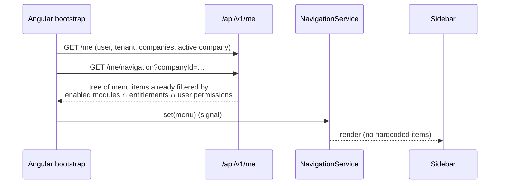

# 16. Angular Feature Architecture

## 16.1 Principles

* **Standalone components + lazy-loaded feature route trees** (no NgModules for features).
* **Signals for state**, RxJS for streams/HTTP. Feature state lives in signal-based stores (`@Injectable` services exposing `signal`/`computed`); no global NgRx store unless a feature demonstrably needs it (ADR-018).
* **Backend is the source of truth** for totals, taxes, prices, permissions and enabled modules. The UI may *preview* calculations by calling preview endpoints (`POST /sales/invoices/preview`), never by reimplementing tax logic.
* **All text localized** (Transloco, runtime language switch, lazy-loaded translation scopes per feature).
* **Angular Material + CDK** themed with Material 3 tokens; one design system wrapper (`erp-*` components) so features don't use Material directly for complex widgets (table, lookup, money input).

## 16.2 Workspace structure

```
frontend/erp-web/src/app/
├── core/                         # singletons, app-wide (imported only by app config)
│   ├── authentication/           # AuthService, token storage (memory + refresh via httpOnly cookie), login flow
│   ├── authorization/            # PermissionService (signal of permission set), *erpHasPermission directive, permissionGuard
│   ├── tenancy/                  # CompanyContextService (active company/branch), company switcher
│   ├── interceptors/             # auth, company-header, idempotency-key, error→ProblemDetails, loading, correlation-id
│   ├── guards/                   # authGuard, moduleEnabledGuard, permissionGuard, unsavedChangesGuard
│   ├── navigation/               # NavigationService: builds menu from /api/v1/me/navigation
│   ├── configuration/            # runtime config (config.json loaded at bootstrap — same build for cloud/on-prem)
│   ├── i18n/                     # Transloco setup, direction (RTL/LTR) handling, locale formats
│   ├── theming/                  # light/dark, density
│   └── services/                 # notification (SignalR), error reporting
├── shared/
│   ├── components/               # erp-data-table, erp-lookup, erp-money-input, erp-quantity-input,
│   │                             # erp-document-header, erp-status-badge, erp-approval-panel,
│   │                             # erp-attachments, erp-audit-trail, erp-page-shell, erp-filter-bar
│   ├── directives/               # barcode-scanner listener, autofocus, keyboard shortcuts, has-permission
│   ├── pipes/                    # money, quantity, localized-date, localized-text
│   ├── validators/               # async code-uniqueness, decimal precision, date ranges
│   ├── forms/                    # document-lines FormArray helpers, server-error mapping to controls
│   └── models/                   # PagedResult<T>, ProblemDetails, LookupItem, DocumentStatus
├── layouts/
│   ├── main-layout/              # header (company switcher, language, theme, notifications), sidebar, breadcrumbs
│   └── auth-layout/
└── features/
    ├── dashboard/  companies/  branches/  products/  customers/  suppliers/
    ├── sales/  pos/  purchasing/  inventory/  manufacturing/
    ├── accounting/  finance/  fixed-assets/  approvals/  reports/  users/  settings/
```

### Inside every feature (example `features/sales/`)

```
sales/
├── sales.routes.ts               # lazy route tree, guards with module + permission metadata
├── pages/                        # routed smart components: invoice-list.page.ts, invoice-edit.page.ts
├── components/                   # presentational: invoice-lines-grid, invoice-totals
├── data-access/
│   ├── api/                      # SalesInvoicesApi (HttpClient, typed DTOs, generated from OpenAPI)
│   └── state/                    # InvoiceEditStore (signals: invoice, lines, totals preview, saving, errors)
├── models/                       # view models & DTO types (generated types re-exported)
├── forms/                        # invoice-form.factory.ts (typed Reactive Forms)
└── i18n/ ar.json en.json         # feature translation scope
```

Boundary rules enforced by ESLint (`eslint-plugin-boundaries` or Nx-style tags): features may import `shared` and `core` public APIs but **never another feature's internals**; cross-feature navigation uses routes, cross-feature data uses API services in `shared/data-access` only when truly shared (e.g. product lookup).

## 16.3 API client generation

TypeScript DTOs and API clients are **generated from the OpenAPI document** (`openapi-typescript` / NSwag) in CI; the generated code is committed under `src/app/api-generated/` and wrapped by hand-written feature API services. A CI check fails if the generated client is stale.

## 16.4 Module- and permission-aware navigation



Each backend module ships a **module manifest** (code, dependencies, permissions, menu contributions with route keys and required permissions). The server composes navigation; the client keeps a route registry mapping route keys → lazy routes. Route guards re-check `moduleEnabled` and `permission` (UX only — the API enforces everything again).

## 16.5 Reusable data table (`erp-data-table`)

* Server-side pagination, sorting and filtering via a `DataSource` adapter that maps table state ↔ `?page=&pageSize=&sort=&filter=` query (API conventions in API_CONTRACTS.md).
* Column definitions as config (`key`, `labelKey`, `type`: text/money/qty/date/status/link, `sortable`, `filter` type, `permission`).
* Column chooser and **saved views** (persisted per user via `/api/v1/me/views/{tableKey}`).
* Row actions declared with required permission and allowed statuses (e.g. *Post* only for `Approved`); hidden when not permitted.
* Export: server-side Excel/PDF (`GET …/export?format=xlsx` with same filters) — never client-side export of only the current page.
* Keyboard: arrow navigation, Enter to open, shortcut keys for actions.

## 16.6 Forms

* Typed Reactive Forms; document line grids are `FormArray`s with keyboard-first editing (Tab/Enter moves cell, Ins adds line, Del removes).
* Lookups (`erp-lookup`): async search with debounce, server paging, keyboard selection, "create new" when permitted; specialized `product-lookup` (barcode, SKU, name AR/EN, variant pick, UOM choice), `customer-lookup`, `warehouse-lookup` (filtered by user warehouse scope), `currency/tax` selectors.
* Server validation errors (`ProblemDetails.errors` with JSON-pointer-like keys `lines[3].quantity`) are mapped onto controls.
* `If-Match` rowversion sent on updates; 412 → "record changed by another user" dialog with reload/compare.
* Unsaved-changes guard on document pages.

## 16.7 RTL/LTR, themes, responsiveness

* Direction set on `<html dir>` from the active language; CDK `Directionality` drives Material; styles use **logical CSS properties** (`margin-inline-start`) only — lint rule forbids `left/right` in component styles.
* Fonts: Arabic-capable font stack (e.g. IBM Plex Sans Arabic / Noto Sans Arabic) + Latin.
* Light/dark themes via M3 color tokens, persisted per user.
* Desktop-first layouts for documents; dedicated mobile-friendly views for operational tasks (stock count entry, goods receipt, approvals, delivery confirmation).

## 16.8 Barcode scanner input

A `BarcodeScannerService` listens to keyboard-wedge input: characters arriving faster than a threshold (e.g. < 30 ms apart) and terminated by Enter are treated as a scan, emitted as a stream, and not inserted into the focused field. POS and receiving screens subscribe; product resolution goes to `GET /catalog/barcodes/{code}` (cached per price version). Camera scanning on mobile is a later enhancement.

## 16.9 POS frontend (special case)

The POS is a separate lazy feature with its own full-screen layout, optimized for touch + scanner. Offline is a future capability, but v1 already:

* generates a **client receipt id (UUID)** per sale and sends it as the idempotency key;
* keeps the in-progress cart in IndexedDB to survive refreshes;
* caches products/prices with a **price version**; the server rejects receipts priced with a stale version beyond policy and returns the repriced cart.
