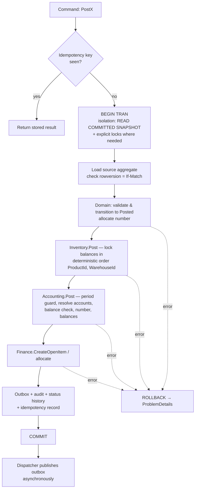

# 19. Transaction Consistency Strategy

## 19.1 Consistency classes

| Class | Examples | Guarantee | Mechanism |
|---|---|---|---|
| **A — Atomic posting** | Posting a sales invoice, GRN, purchase invoice, delivery, stock transfer issue/receive, adjustment, production issue/receipt, receipt/payment, depreciation run (per asset), POS receipt | All ledger effects (document status, inventory movements & balances & cost, journal & account balances, open items, number allocation, outbox, audit) commit **together or not at all** | One SQL Server transaction on one connection shared by all participating module DbContexts, orchestrated by the source module's **Posting Coordinator** (ADR-006) |
| **B — Single aggregate** | Edit draft, approve, master-data change | Aggregate invariants | One DbContext `SaveChanges` with rowversion |
| **C — Eventual** | Notifications, reporting summary tables, supplier price history, search index, webhooks, commission *notifications*, approval-request creation side effects | At-least-once, idempotent consumers, ordered per aggregate | Transactional **outbox** + dispatcher + **inbox** dedupe |

## 19.2 Why a shared transaction (and how it stays extractable)

The spec allows "an atomic posting process or a reliably coordinated posting workflow" and forbids relying on distributed transactions across *future* services. Inside the monolith, all modules share one database (shared and per-tenant models alike), so a local transaction is the simplest **correct** option: COGS depends on the inventory issue cost, the journal depends on COGS, and the AR open item depends on the posted number — a saga here would expose half-posted documents to users and reports.

To keep extraction possible:

1. Modules interact only through **posting contracts** (`IInventoryPostingService.Post(PostingRequest)`), never through each other's DbContexts or tables.
2. Every posting request carries a **unique `SourceDocumentReference`**; the callee enforces uniqueness (DB unique index) ⇒ calls are **idempotent** and could be replayed as messages.
3. Every posting contract has a **reverse operation** (`Reverse(SourceDocumentReference)`), i.e. a ready-made compensating action.
4. Contracts return values (e.g. cost) that a future async design would carry in a reply event.

When a module is extracted, its contract implementation becomes a client sending a command through the outbox, and the coordinator becomes a durable process manager (state persisted, compensations on failure). No domain code changes.

## 19.3 Posting coordinator pattern

Implementation notes:

* `IUnitOfWork` opens one `DbConnection` + `DbTransaction`; each module DbContext participating in the posting is created with that connection and `Database.UseTransaction(tx)`. Execution strategy (`EnableRetryOnFailure`) wraps the **whole** unit so a transient failure retries the full posting, not a fragment.
* Database: `READ_COMMITTED_SNAPSHOT ON` so readers (reports, lists) never block posting.
* **Deadlock avoidance**: balance rows locked in a deterministic order (sorted by ProductId, VariantId, WarehouseId, BatchId); number sequences locked last-but-one; account balances updated last in sorted order.
* **Transaction size**: large batch operations (e.g. stock count with 20 000 lines, depreciation run) are split into per-document or per-chunk transactions, each idempotent, tracked by a batch job record.

## 19.4 Inventory concurrency

* `InventoryBalance` update uses a single statement pattern: `UPDATE … SET OnHand = OnHand + @delta … OUTPUT inserted.OnHand WHERE … AND (@allowNegative = 1 OR OnHand + @delta >= 0)` under the posting transaction; zero rows ⇒ insufficient stock error. Rows are created on first receipt (`MERGE` with `HOLDLOCK` or insert-then-update with unique key retry).
* `ItemValuation` (WAC) updated with `UPDLOCK` in the same transaction so average cost is computed against a stable state; `PostingSequence` per valuation area taken from that locked row ⇒ deterministic costing order.
* FIFO layers consumed oldest-first with `UPDLOCK, READPAST` **not** used (must be exact); layers locked in order of receipt.
* Reservations: `Reserved` column updated in the same row as `OnHand`; availability check is `OnHand − Reserved ≥ requested` within the lock.

## 19.5 Optimistic concurrency for editing

* All aggregate roots have `rowversion`; API returns it as `ETag`; updates/actions require `If-Match`; mismatch ⇒ **412 Precondition Failed**.
* Posting checks the rowversion of the document the user saw, preventing posting a document that was edited by someone else in the meantime.

## 19.6 Idempotency

| Where | Key | Store |
|---|---|---|
| Posting, payment, receipt, POS endpoints | `Idempotency-Key` header (UUID, client-generated) | `core.IdempotencyRecord` (tenant, key, endpoint, request hash, response) written **in the same transaction** as the effect; replay returns the stored response; same key + different body ⇒ 422 |
| POS receipts | `ClientReceiptId` | Unique index (TerminalId, ClientReceiptId) |
| Module posting contracts | `SourceDocumentReference` | Unique indexes on movements, journals, open items |
| Integration event consumers | MessageId + consumer name | Inbox table |
| Scheduled jobs (depreciation, FX revaluation, recurring) | (job type, scope, period) | Unique run record |

## 19.7 Transactional outbox

* Domain/integration events appended to `<schema>.OutboxMessage` by the SaveChanges interceptor **in the business transaction**.
* `OutboxDispatcher` (worker role) polls with `UPDLOCK, READPAST, ROWLOCK` batches, publishes to in-process consumers (v1) or a broker (future), marks processed; exponential backoff; poison messages after N attempts go to a dead-letter state surfaced on the admin dashboard.
* Ordering: per aggregate id (messages for the same aggregate processed sequentially).
* Consumers are idempotent via inbox.

## 19.8 Number allocation

* Draft documents get a non-legal draft number (`DRAFT-…` or GUID short code).
* The legal number is allocated **inside the posting transaction** from `NumberSequence` with `UPDLOCK, HOLDLOCK` ⇒ concurrency-safe and **gapless** (a rollback also rolls back the increment).
* High-volume POS: per-terminal sequences (prefix includes terminal code) avoid hot-row contention.

## 19.9 Failure handling & reconciliation

| Failure | Handling |
|---|---|
| Transient SQL error/deadlock | Full posting retried by execution strategy (idempotent) |
| Business rule failure (insufficient stock, missing posting rule, closed period) | Rollback; actionable error code; nothing partially posted |
| Outbox consumer failure | Retries with backoff → dead letter → alert; business data already consistent |
| Logic bug causing drift | Nightly reconciliation jobs (see posting doc §11.4) detect GL ↔ subledger ↔ ledger differences and alert; fixes via adjustment/reversal documents only |
| Offline POS (future) | Receipts queued locally with client ids; server sync is idempotent; conflicts (price changed, stock short, serial already sold) recorded as sync exceptions for supervisor resolution — never silently merged |
