# 3. Business Capability Map

## 3.1 Capability tiers

Capabilities are split into three tiers. **Core** is always installed and cannot be disabled. **Standard business modules** are licensed/activated per tenant and enabled per company. **Specialized modules** are only enabled for business models that need them.

```mermaid
flowchart TB
    subgraph CORE["CORE PLATFORM — always on (mandatory)"]
        direction LR
        IAM[Identity & Access]
        TEN[Tenancy & Organization<br/>Tenant · Company · Legal Entity · Branch · Warehouse]
        CFG[Configuration & Module Activation<br/>Business Policies]
        LOC[Localization AR/EN]
        AUD[Audit]
        NUM[Document Numbering]
        NOT[Notifications]
        FIL[File Storage]
        WF[Approval Workflow Engine]
    end

    subgraph MD["MASTER DATA — mandatory"]
        direction LR
        CAT[Catalog<br/>Products · Variants · UOM · Barcodes]
        PTY[Parties<br/>Customers · Suppliers]
        HRB[Employees · Salespersons]
        TAX[Tax & Currency]
        PRC[Price Lists]
    end

    subgraph FIN["FINANCE — mandatory"]
        direction LR
        GL[General Ledger<br/>COA · Journals · Periods]
        AR[Accounts Receivable]
        AP[Accounts Payable]
        CASH[Cash & Bank]
        FREP[Financial Statements]
    end

    subgraph OPS["STANDARD OPERATIONS — optional, enabled per company"]
        direction LR
        INV[Inventory]
        SAL[Sales]
        PUR[Procurement]
        EXP[Expenses]
        REP[Operational Reporting]
    end

    subgraph SPEC["SPECIALIZED — optional"]
        direction LR
        POS[Point of Sale]
        MFG[Manufacturing<br/>BOM · Routing · Production · MRP]
        DIST[Distribution extensions<br/>Routes · Van sales — future]
        FA[Fixed Assets]
        BTS[Batch / Serial / Expiry tracking]
        COM[Sales Commissions]
        MC[Multi-Currency]
        SUB[Subscription / Licensing integration]
    end

    CORE --> MD --> FIN
    MD --> OPS
    OPS --> SPEC
    FIN --- OPS
```

## 3.2 Mandatory vs optional

| Capability | Tier | Can be disabled? | Notes |
|---|---|---|---|
| Identity, roles, permissions | Core | No | |
| Tenancy & organization structure | Core | No | Legal entity always exists (one per company by default) |
| Configuration, module activation, policies | Core | No | |
| Localization (AR/EN, RTL/LTR) | Core | No | |
| Audit | Core | No | Financial & inventory audit cannot be switched off |
| Document numbering | Core | No | |
| Notifications, file storage | Core | No | Providers are pluggable |
| Approval workflow engine | Core | No (engine) | Individual approval *definitions* are optional |
| Catalog, parties, tax, currency (base) | Master data | No | Multi-currency **transactions** are optional |
| General ledger, AR, AP, cash & bank, statements | Finance | No | Spec Part 12: "mandatory core module" |
| Inventory | Standard | Yes | Service-only companies disable it |
| Sales | Standard | Yes (rare) | |
| Procurement | Standard | Yes | |
| Expense management | Standard | Yes | |
| POS | Specialized | Yes | Requires Sales + Inventory |
| Manufacturing | Specialized | Yes | Requires Inventory + Procurement |
| Fixed assets | Specialized | Yes | Requires GL |
| Batch / serial / expiry tracking | Specialized (policy) | Yes | Per-company policy **and** per-product flag |
| Sales commissions | Specialized (policy) | Yes | |
| Multi-currency transactions | Specialized (policy) | Yes | Base currency always exists |
| Distribution (routes, van sales, delivery planning) | Specialized | Yes | Not in spec scope beyond "Distribution" business model — see open questions |
| Subscription & billing | Integration | Yes | Never a dependency of ERP business core |

## 3.3 Module dependency rules

Activation is validated against these dependencies (enforced by the module registry, not by UI only):

| Module | Requires |
|---|---|
| Sales | Master data, Finance |
| Procurement | Master data, Finance |
| Inventory | Master data, Finance |
| POS | Sales, Inventory |
| Manufacturing | Inventory, Procurement |
| Fixed Assets | Finance |
| Sales Commissions | Sales |
| Batch/Serial/Expiry | Inventory |

## 3.4 Business model presets

A "business model" is **only a preset** that pre-selects modules and default policies during company setup. After setup, the company's behavior is determined exclusively by its explicit module activations and policy values — application code never branches on the business model name (Part 5).

| Preset | Modules enabled | Notable default policies |
|---|---|---|
| Retail | Sales, Inventory, Procurement, POS | Tax-inclusive prices on, negative stock off, walk-in customer on |
| Wholesale | Sales, Inventory, Procurement | Credit limits on, volume discounts on, price lists per customer group |
| Trading | Sales, Inventory, Procurement, Multi-currency | Landed costs on, receipt-before-invoice on |
| Distribution | Sales, Inventory, Procurement, Reservations | Warehouse reservations on, partial deliveries on, salesperson commissions on |
| Manufacturing | Sales, Inventory, Procurement, Manufacturing | Batch tracking available, WIP accounting on |
| Services | Sales, Procurement (non-stock), Expenses | Inventory module off; only Service/Consumable product types allowed |

## 3.5 Capability-to-context ownership

| Capability | Owning bounded context (module) |
|---|---|
| Users, roles, permissions, tokens | `Identity` |
| Tenant, company, legal entity, branch, department, warehouse **definition** | `Organization` |
| Module activation, business policies, settings | `Configuration` |
| Products, variants, UOM, categories, brands, barcodes | `Catalog` |
| Price lists, customer pricing, discounts | `Pricing` (sub-module of Catalog in Phase 3; separable) |
| Customers, suppliers, contacts, addresses, payment terms | `Parties` (schema `crm`) |
| Employees, salespersons | `Organization` (Phase 3); HR is out of scope |
| Tax codes, rates, exchange rates, currencies | `Tax` |
| Quotations, sales orders, deliveries, invoices, returns, commissions | `Sales` |
| POS terminals, sessions, receipts, cash drawer | `POS` |
| PR, RFQ, PO, GRN, purchase invoices, returns, landed cost | `Procurement` |
| Stock ledger, balances, reservations, transfers, adjustments, counts, cost layers, batches, serials | `Inventory` |
| BOM, routing, work centers, production orders, MRP | `Manufacturing` |
| COA, fiscal calendar, journals, posting rules, cost/profit centers | `Accounting` |
| AR/AP subledgers, receipts, payments, allocations, cash/bank, reconciliation, expenses | `Finance` |
| Asset register, depreciation | `FixedAssets` |
| Approval definitions/instances | `Workflow` |
| Audit log, document history | `Audit` |
| Document numbering, templates, attachments | `Documents` (platform) |
| Read models, report definitions, dashboards | `Reporting` |
