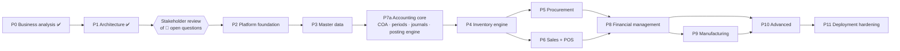

# 20. Implementation Roadmap

Each phase ends with a **runnable application**, passing builds/tests, validated migrations and updated governance docs (Part 25). Phases deliver vertical slices (API + UI + tests), not layers.

### Recommended sequencing change (needs approval)

The specification orders Accounting Foundation as Phase 7, after Inventory, Procurement and Sales. Because Part 22 requires every posted inventory/sales/purchase document to produce balanced journal entries **at posting time**, building those modules before the posting engine would mean either retrofitting postings later or shipping documents that "post" without accounting. **Recommendation: move the accounting core (COA, fiscal periods, journal entries, posting rules engine, trial balance) to Phase 3b/"7a", before Inventory.** Full AR/AP/cash/statements stay in Phase 8. This is recorded as ADR-019 (proposed).

| Phase | Scope | Key dependencies | DB changes | API | Frontend | Tests | Exit criteria |
|---|---|---|---|---|---|---|---|
| **P2 Platform foundation** | Solution skeleton, building blocks, Identity (login, refresh rotation, MFA-ready), tenancy (shared DB + RLS), organization (company/LE/branch/warehouse), configuration (modules, policies), permissions & roles, localization, Serilog/OTel, ProblemDetails, audit, numbering, outbox, idempotency, file storage, health checks, Docker Compose dev | — | schemas `identity`, `organization`, `core`, `audit` | `/auth`, `/me`, `/organization/*`, `/configuration/*`, `/identity/*` | Angular workspace, layouts, auth, company switcher, dynamic nav, data table, i18n AR/EN RTL, themes | arch tests, tenant isolation suite, auth tests, numbering concurrency | Two tenants isolated; admin manages users/roles/companies in AR & EN |
| **P3 Master data** | Products/variants/UOM/barcodes/categories/brands, customers, suppliers, payment terms, warehouses UI, price lists, tax codes/groups, currencies/exchange rates, employees/salespersons, import framework (CSV/Excel, dry-run) | P2 | `catalog`, `crm`, `tax` | `/catalog/*`, `/parties/*`, `/tax/*` | feature pages + lookups | UOM conversion property tests, price resolution, tax calc | Products sellable/stockable defined with UOMs, prices, taxes |
| **P7a Accounting core** (moved up) | COA (hierarchy, control accounts), fiscal years/periods, manual journals, posting engine + account determination, account balances, GL & trial balance reports, COA template | P3 | `accounting` | `/accounting/*` | COA tree, journal entry, period mgmt, TB | balancing, period guard, determination, immutability | Manual journals post & reverse; TB balances |
| **P4 Inventory engine** | Opening stock, ledger, balances, WAC + FIFO engine, valuation areas, transfers (in-transit), adjustments, reservations, stock count, batch/serial/expiry, inventory GL postings, stock reports | P3, P7a, 🔴 OQ-INV-1..4 | `inventory` | `/inventory/*` | stock inquiry, documents, count entry (mobile) | costing property tests, concurrency S-7, S-4 | Inventory GL = valuation reconciliation passes |
| **P5 Procurement** | PR, RFQ/quotation comparison, PO, GRN with inspection, purchase invoice (3-way match, PPV), returns, landed cost, supplier open items (basic) | P4, 🔴 OQ-PUR-1 | `procurement` | `/procurement/*` | documents, matching screen | S-2 (up to invoice) | GRNI clears; no double counting |
| **P6 Sales + POS** | Quotation, SO, reservations, delivery, invoice, returns/credit notes, credit limit, pricing pipeline, commissions (basic), POS (terminals, shifts, receipts, split payments, refunds, cash reconciliation, receipt printing) | P4, 🔴 OQ-SAL-1, MR-1/OQ-TAX-1 | `sales`, `pos` | `/sales/*`, `/pos/*` | documents, POS UI | S-1 (to invoice), S-5, S-9 | Order-to-invoice posts inventory+GL atomically |
| **P8 Financial management** | AR/AP open items, receipts/payments, allocations, advances, withholding, cash & bank accounts, transfers, bank reconciliation, expenses, FX realized/unrealized, aging, statements, financial statements (IS, BS, CF indirect), tax reports, year-end close | P5, P6 | `finance` | `/finance/*`, `/reports/financial/*` | finance pages, statements | S-1/S-2 complete, S-6, S-10 | Subledger = control accounts; statements from GL only |
| **P9 Manufacturing** | Work centers, routings, BOM versions (multi-level, alternatives), production orders, issue/backflush, operation reporting, FG receipt, scrap, WIP accounting, actual costing, variance at close, basic MRP | P4, P5, P8, 🔴 OQ-MFG-1 | `manufacturing` | `/manufacturing/*` | BOM editor, production order, MRP results | S-3, BOM cycle, MRP netting | WIP reconciles; documented cost limitations |
| **P10 Advanced** | Approval engine UI & rules (engine core already used from P5/P6), delegation & escalation, fixed assets & depreciation, advanced pricing/promotions, dashboards/dashboard builder, webhooks/public API, subscription integration port, recurring invoices | P8 | `workflow`, `assets`, `reporting` | various | — | depreciation, approval rules | — |
| **P11 Deployment** | Production Dockerfiles, Helm (SaaS), on-prem offline bundles (Linux & Windows), migrator with approvals, backup/restore scripts & tests, monitoring dashboards, security hardening (ZAP, pen-test fixes), DB-per-tenant routing | all | tenant catalog | `/platform/*` | — | upgrade tests, restore drill | Clean install & upgrade on-prem without internet |

Note: the **approval engine core** (definitions, instances, approve/reject) is pulled forward into P5/P6 because PO and invoice approvals are needed there; P10 adds delegation, escalation and the rule designer UI.

## Before every phase (checklist)

1. Dependencies & blocking open questions resolved.
2. Affected modules, DB changes, API changes, frontend changes listed in DEVELOPMENT_STATUS.md.
3. Test plan (which scenario suites extend).

## After every phase (checklist)

1. Backend build + all tests; frontend lint/test/build.
2. Migrations generated, applied to a clean DB **and** upgraded from previous phase's DB.
3. REQUIREMENTS_TRACEABILITY.md statuses updated; DEVELOPMENT_STATUS.md, API_CONTRACTS.md, KNOWN_LIMITATIONS.md, ARCHITECTURE_DECISIONS.md updated.
4. Report of completed vs pending requirements.
