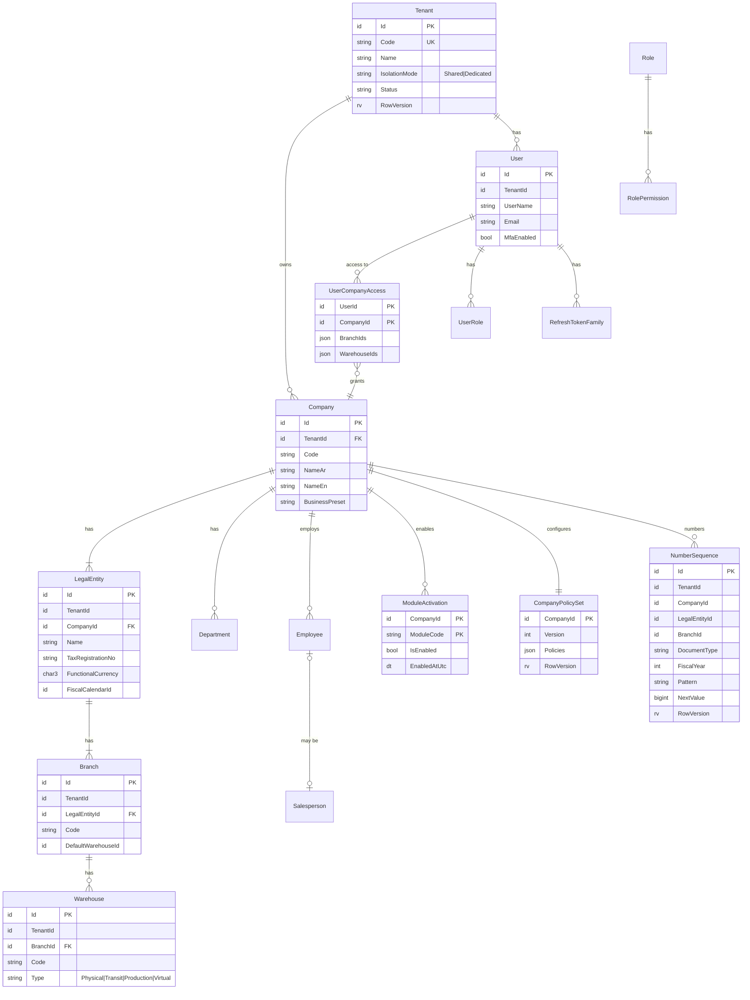
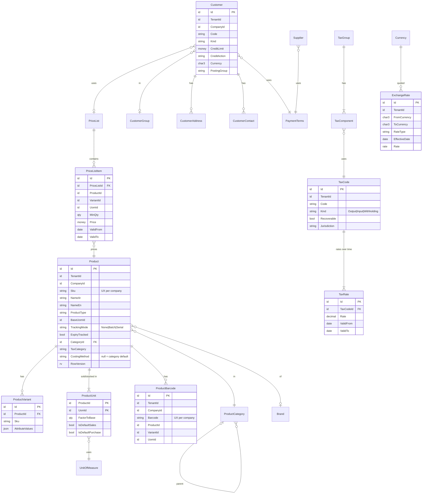
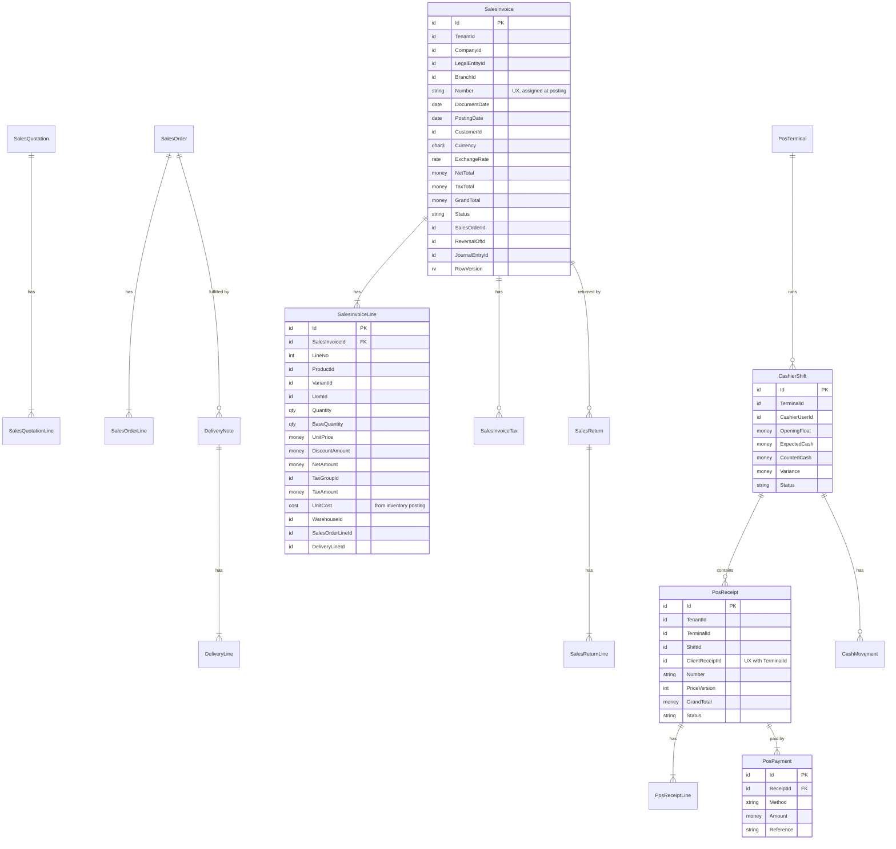
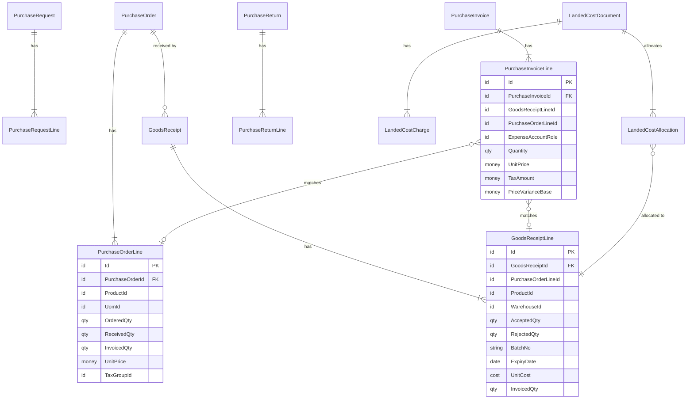
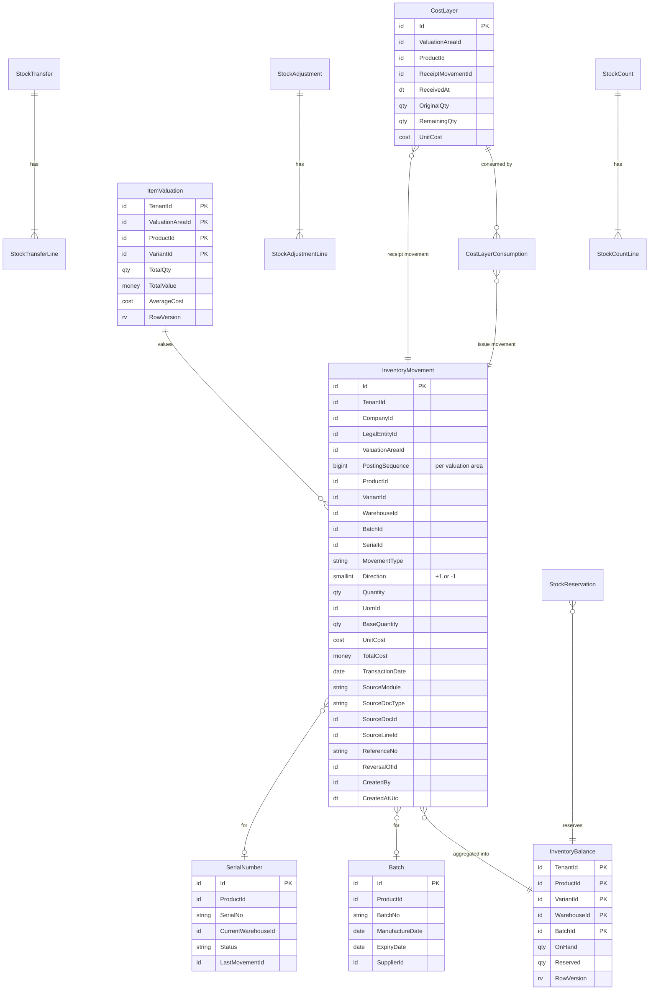
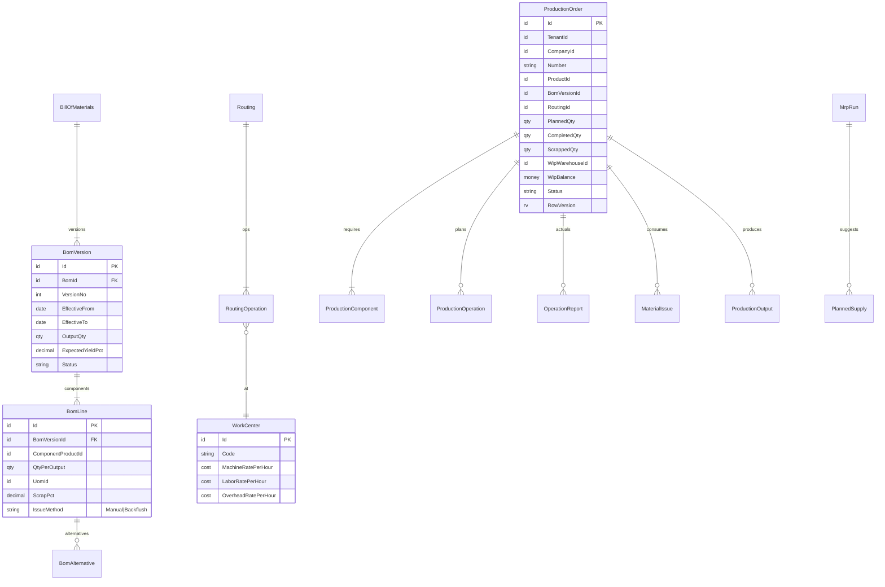
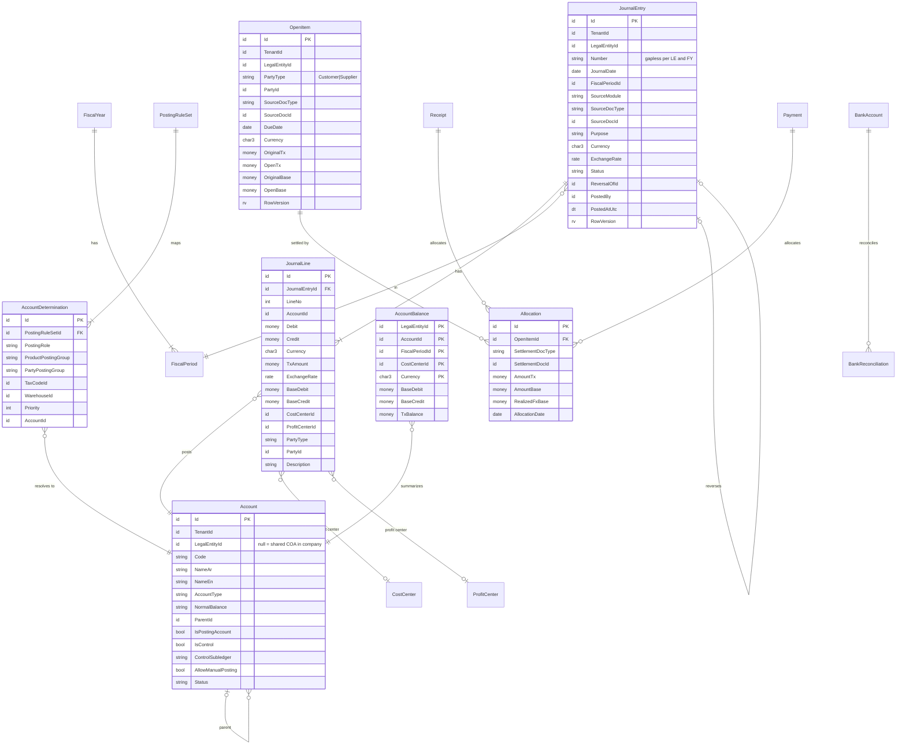

# 6. Database ERD

The ERD is split by schema (bounded context). Cross-schema relationships are **logical references by ID** — no foreign keys are created across module schemas (so a module can be moved to its own database later) except to `organization` tenancy tables, which every module may reference (ADR-005). Integrity across schemas is protected by application rules and reconciliation jobs.

Column types in diagrams are abbreviated: `money` = `decimal(19,4)`, `qty` = `decimal(18,6)`, `cost` = `decimal(19,6)`, `rate` = `decimal(18,8)`, `id` = `uniqueidentifier`, `rv` = `rowversion`, `dt` = `datetime2(3)` UTC.

## 6.1 Global database rules

| Rule | Implementation |
|---|---|
| Primary keys | `uniqueidentifier` generated in the application with a **SQL-Server-ordered sequential GUID** generator (EF Core `SequentialGuidValueGenerator` semantics). Note: plain UUIDv7 is *not* sequential under SQL Server's GUID sort order, so it is not used for clustered keys (ADR-008). |
| Tenant column | `TenantId id NOT NULL` on every tenant-scoped table, first column of every business index and unique constraint |
| Company column | `CompanyId` on company-scoped tables |
| Unique constraints | Tenant/company-scoped: e.g. `UX_catalog_Product_TenantId_CompanyId_Sku` |
| Concurrency | `RowVersion rowversion` on every aggregate root table |
| Money/qty | Explicit precision everywhere (EF convention + analyzer test fails on any unconfigured decimal) |
| Time | `datetime2(3)` UTC (`…Utc` suffix); business dates (`DocumentDate`, `PostingDate`) as `date` |
| Deletes | `ON DELETE NO ACTION` everywhere; soft delete (`IsDeleted`) only for master data; posted documents and ledgers never deleted |
| Naming | Tables singular PascalCase; FKs `FK_<schema>_<Table>_<RefTable>_<Column>`; indexes `IX_`/`UX_` |
| Ledger protection | `inventory.InventoryMovement`, `accounting.JournalLine` (posted), `audit.AuditLog`: application DB user has no UPDATE/DELETE grant; INSTEAD OF UPDATE/DELETE triggers as second line |
| Row-level security | SQL Server RLS security policy on `TenantId` using `SESSION_CONTEXT('TenantId')` (defense in depth, ADR-004) |

## 6.2 Organization, identity, configuration

## 6.3 Catalog, parties, tax

## 6.4 Sales & POS

## 6.5 Procurement

## 6.6 Inventory

Unique index enforcing single posting per source line:
`UX_inventory_InventoryMovement_Source (TenantId, SourceDocType, SourceDocId, SourceLineId, MovementType, Direction, BatchId, SerialId)` — reversal movements carry their own source (the reversal document).

## 6.7 Manufacturing

## 6.8 Accounting & finance

Database check constraints on `accounting.JournalLine`: `CK_JournalLine_OneSided CHECK ((Debit = 0 AND Credit > 0) OR (Credit = 0 AND Debit > 0))`. Balance (Σ debit = Σ credit) is validated in the domain and re-verified in the posting transaction with a set-based query before commit.

## 6.9 Platform tables (every module schema)

| Table | Purpose |
|---|---|
| `<schema>.OutboxMessage` | Id, OccurredAtUtc, Type, Payload (json), TenantId, CorrelationId, ProcessedAtUtc, Attempts, Error |
| `<schema>.InboxMessage` | MessageId + Consumer (PK) — idempotent consumption |
| `core.IdempotencyRecord` | (TenantId, Key, Endpoint) PK, request hash, response status/body, expires |
| `audit.AuditLog` | Id, TenantId, UserId, Action, EntityType, EntityId, BeforeJson, AfterJson, CorrelationId, AtUtc, PrevHash, Hash |
| `core.DocumentStatusHistory` | document ref, from, to, user, reason, at |
| `core.Attachment` | owner doc ref, storage key, file name, content type, size, hash |
