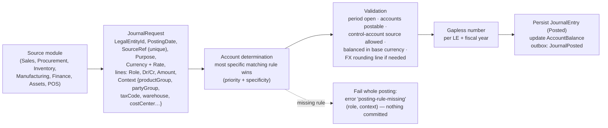
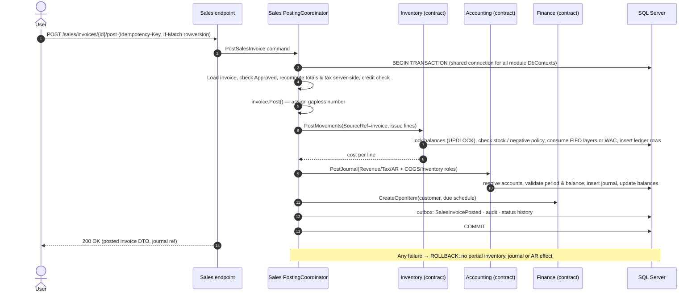
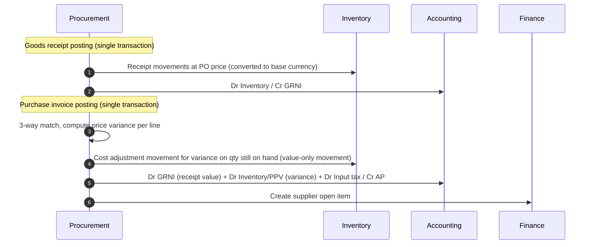

# 11–12. Accounting Posting Workflows and Journal Entry Examples

## 11.1 Posting engine design

Operational modules never choose GL accounts. They send a **Journal Request** to `Accounting.Contracts.IJournalPostingService` containing **semantic posting roles**, amounts and *determination context*. Accounting resolves each role to an account through the legal entity's **PostingRuleSet** (account determination), validates, numbers and posts the journal.

### Posting roles (initial catalogue)

| Area | Roles |
|---|---|
| Receivables | `CustomerReceivable`, `CustomerAdvance`, `CustomerRefundPayable` |
| Payables | `SupplierPayable`, `SupplierAdvance` |
| Sales | `SalesRevenue`, `SalesDiscount`, `SalesReturns`, `ServiceRevenue`, `CashRounding` |
| Tax | `OutputTax`, `InputTax`, `NonRecoverableInputTax` (→ cost), `WithholdingTaxPayable`, `WithholdingTaxReceivable` |
| Inventory | `Inventory` (resolved by product posting group + warehouse), `CostOfGoodsSold`, `InventoryAdjustmentLoss`, `InventoryAdjustmentGain`, `InventoryInTransit`, `GoodsReceivedNotInvoiced`, `GoodsInvoicedNotReceived`, `PurchasePriceVariance`, `LandedCostClearing`, `OpeningBalanceEquity`, `CostTrueUp` |
| Manufacturing | `WorkInProgress`, `AppliedLabor`, `AppliedMachine`, `AppliedOverhead`, `ProductionVariance`, `AbnormalScrap` |
| Cash & bank | `CashAccount` / `BankAccount` (resolved from the specific cash/bank account), `BankCharges`, `CashOverShort`, `InternalTransferClearing` |
| FX | `RealizedFxGain`, `RealizedFxLoss`, `UnrealizedFxGain`, `UnrealizedFxLoss`, `FxRoundingDifference` |
| Fixed assets | `FixedAssetCost`, `AccumulatedDepreciation`, `DepreciationExpense`, `AssetDisposalGainLoss`, `AssetRevaluationReserve` |
| Year-end | `RetainedEarnings`, `CurrentYearEarnings` |

**Accounting readiness check:** enabling a module (or posting the first document of a type) requires that every role the module can emit resolves to an account for the legal entity. This turns a runtime posting failure into a setup-time validation.

## 11.2 Sales invoice posting workflow (invoice-driven inventory policy)

## 11.3 Purchase flows (receipt-before-invoice policy)

Invoice-before-receipt (policy): invoice posts `Dr GoodsInvoicedNotReceived + Dr Input tax / Cr AP`; GRN later posts `Dr Inventory / Cr GoodsInvoicedNotReceived`. Exactly one of the two clearing accounts is used per PO line, which prevents double counting of inventory or liability.

## 12. Journal entry examples

All examples: base currency **EGP** (illustrative only — the engine is currency- and jurisdiction-agnostic), VAT **14 %** used purely as an example rate. Account names are the resolved accounts for the roles shown.

### J-1 Sales invoice (invoice-driven): 10 units × 100.00, VAT 14 %, WAC 62.50

| Account (role) | Debit | Credit |
|---|---:|---:|
| Accounts Receivable – Trade (`CustomerReceivable`) | 1,140.00 | |
| Sales Revenue – Goods (`SalesRevenue`) | | 1,000.00 |
| Output VAT Payable (`OutputTax`) | | 140.00 |
| Cost of Goods Sold (`CostOfGoodsSold`) | 625.00 | |
| Inventory – Finished Goods (`Inventory`) | | 625.00 |
| **Total** | **1,765.00** | **1,765.00** |

Inventory ledger: 1 movement `SalesIssue`, −10 base units, unit cost 62.50, total 625.00. AR open item 1,140.00.

### J-2 Delivery-driven variant (delivery then invoice)

Delivery note posting: `Dr COGS 625.00 / Cr Inventory 625.00`.
Invoice posting: `Dr AR 1,140.00 / Cr Revenue 1,000.00 / Cr Output VAT 140.00`. No inventory movement at invoice (the invoice line references the delivery line, which the unique source index enforces).

### J-3 Goods receipt: 100 units × 60.00

| Account | Debit | Credit |
|---|---:|---:|
| Inventory – Raw/Trading (`Inventory`) | 6,000.00 | |
| Goods Received Not Invoiced (`GoodsReceivedNotInvoiced`) | | 6,000.00 |

### J-4 Supplier invoice for J-3 at 61.00/unit, VAT 14 %, all 100 units still on hand

| Account | Debit | Credit |
|---|---:|---:|
| Goods Received Not Invoiced | 6,000.00 | |
| Inventory (price difference, stock on hand) | 100.00 | |
| Input VAT Recoverable (`InputTax`) | 854.00 | |
| Accounts Payable – Trade (`SupplierPayable`) | | 6,954.00 |
| **Total** | **6,954.00** | **6,954.00** |

If 40 of the 100 units had already been sold before the invoice, the 100.00 difference splits into **Inventory 60.00** and **Purchase Price Variance 40.00** (OQ-PUR-1), and Inventory posts a value-only cost adjustment movement of +60.00.

### J-5 Customer receipt settling J-1 by bank transfer

| Account | Debit | Credit |
|---|---:|---:|
| Bank – Current Account (`BankAccount`) | 1,140.00 | |
| Accounts Receivable – Trade | | 1,140.00 |

Finance: allocation 1,140.00 → open item closed → `InvoiceSettled` → invoice status `Paid`.

### J-6 Supplier payment for J-4 with 1 % withholding tax on the net amount (6,100.00)

| Account | Debit | Credit |
|---|---:|---:|
| Accounts Payable – Trade | 6,954.00 | |
| Bank – Current Account | | 6,893.00 |
| Withholding Tax Payable (`WithholdingTaxPayable`) | | 61.00 |

### J-7 Stock adjustment (loss): 3 units at current WAC 62.50, reason "Damaged"

| Account | Debit | Credit |
|---|---:|---:|
| Inventory Adjustment Loss (`InventoryAdjustmentLoss`) | 187.50 | |
| Inventory | | 187.50 |

A count gain reverses the sides using `InventoryAdjustmentGain`.

### J-8 Sales return of 2 units from J-1 (restocked at original cost 62.50)

| Account | Debit | Credit |
|---|---:|---:|
| Sales Returns (`SalesReturns`) | 200.00 | |
| Output VAT Payable | 28.00 | |
| Accounts Receivable – Trade | | 228.00 |
| Inventory | 125.00 | |
| Cost of Goods Sold | | 125.00 |

### J-9 Manufacturing: 100 × Finished Product A (BOM: 2 X, 3 Y, 1 Z per unit)

Material issue (X 200 × 5.00, Y 300 × 2.00, Z 100 × 4.00):

| Account | Debit | Credit |
|---|---:|---:|
| Work in Progress (`WorkInProgress`) | 2,000.00 | |
| Inventory – Raw Materials | | 2,000.00 |

Operation reporting (labor 10 h × 30.00, machine 8 h × 50.00, overhead 8 machine-h × 25.00):

| Account | Debit | Credit |
|---|---:|---:|
| Work in Progress | 900.00 | |
| Applied Labor (`AppliedLabor`) | | 300.00 |
| Applied Machine Cost (`AppliedMachine`) | | 400.00 |
| Applied Overhead (`AppliedOverhead`) | | 200.00 |

Finished goods receipt (100 units, unit cost 29.00):

| Account | Debit | Credit |
|---|---:|---:|
| Inventory – Finished Goods | 2,900.00 | |
| Work in Progress | | 2,900.00 |

WIP balance after receipt = 0 → no variance at close. The "applied" accounts are cleared against actual payroll/overhead expense at period end (absorption variance) — this is why full manufacturing cost accounting is **not** claimed until those rules are implemented and tested (Part 11.4).

### J-10 Foreign-currency invoice and realized FX difference

Invoice USD 1,000.00 at rate 50.00: `Dr AR 50,000.00 (USD 1,000) / Cr Revenue 50,000.00`.
Receipt USD 1,000.00 at rate 51.00:

| Account | Tx (USD) | Debit (EGP) | Credit (EGP) |
|---|---:|---:|---:|
| Bank – USD Account | 1,000.00 | 51,000.00 | |
| Accounts Receivable – Trade | 1,000.00 | | 50,000.00 |
| Realized FX Gain (`RealizedFxGain`) | — | | 1,000.00 |

### J-11 POS shift close with cash shortage of 20.00

Shift sales summary journal per payment method (aggregated by tax code), plus:

| Account | Debit | Credit |
|---|---:|---:|
| Cash Over/Short (`CashOverShort`) | 20.00 | |
| Cash Drawer – Terminal 01 (`CashAccount`) | | 20.00 |

### J-12 Monthly straight-line depreciation: cost 120,000.00, life 10 years, no salvage

| Account | Debit | Credit |
|---|---:|---:|
| Depreciation Expense (`DepreciationExpense`) | 1,000.00 | |
| Accumulated Depreciation (`AccumulatedDepreciation`) | | 1,000.00 |

### J-13 Reversal of J-1 (cancellation workflow, no allocations yet)

A new journal `ReversalOf = J-1`, dated in an **open** period (default: cancellation date), with every line's debit and credit swapped. The original journal stays `Posted` and is flagged `Reversed`; nothing is edited or deleted. Inventory receives a reversal movement at the original cost 62.50.

## 11.4 Reconciliation controls (scheduled jobs)

| Control | Check |
|---|---|
| Trial balance | Σ base debit = Σ base credit per legal entity per period |
| AR / AP | Control account balance = Σ open items (base) per legal entity |
| Inventory | Inventory GL accounts = Σ `ItemValuation.TotalValue` mapped to those accounts |
| GRNI | GRNI balance = Σ (received − invoiced) value of GRN lines |
| WIP | WIP account = Σ open production orders' WIP balance |
| Ledger vs balance tables | `InventoryBalance` = Σ movements; `AccountBalance` = Σ journal lines |

Differences raise alerts and are listed on an "Integrity dashboard"; they are never auto-corrected silently.
